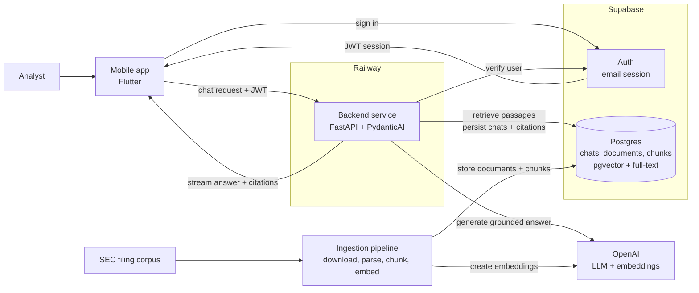

# Document Copilot Architecture

## Purpose

Document Copilot is an internal research assistant for analysts who need grounded answers from a curated SEC filing corpus. The architecture must optimize for trust: every answer is generated from retrieved source passages, every factual claim is citable, and the system fails clearly when the corpus does not support an answer.

This document describes the target architecture for the chat experience, LLM orchestration, and the communication layer between the Flutter app, Supabase, and FastAPI backend.

## High-Level Architecture

The best opening diagram is a service-level view that shows the two core paths: the live chat path that serves users, and the ingestion path that prepares SEC filings for retrieval.



## Architectural Goals

- Keep the app thin: it renders chat state, manages the user's Supabase session, and streams assistant responses.
- Keep the backend authoritative: retrieval, grounding, citation checks, tool execution, and database writes happen in FastAPI.
- Use Supabase for identity and durable product state: users, chat threads, source documents, chunks, embeddings, and citation metadata.
- Use Supabase `pgvector` for semantic retrieval and Postgres full-text search for keyword retrieval.
- Make the LLM path typed and testable by using PydanticAI agents with explicit dependencies, outputs, and tool boundaries.
- Preserve a simple deployment model: one stateless backend service on Railway, hosted Supabase, and the Flutter app distributed as test builds for the pilot.

## Stack

Frontend:

- Flutter (Dart 3)
- `flutter_bloc` (Cubits) for state, `get_it` for dependency injection
- Material widgets for UI, plain `Navigator` with an auth gate
- `@supabase/supabase-js` for auth, with the session stored on the device
- Dio for HTTP, including reading the Server-Sent Events answer stream

Backend:

- Python 3.12+
- FastAPI + Uvicorn
- Pydantic v2 + pydantic-settings
- PydanticAI for typed LLM orchestration
- OpenAI SDK for generation and embeddings
- Supabase Python client for server-side database access
- SQLAlchemy models + Alembic migrations for schema management
- Supabase `pgvector` for semantic search
- Postgres full-text search for lexical retrieval
- `httpx` for outbound HTTP
- `structlog` for structured logs

Persistence:

- Supabase Auth for email login
- Supabase Postgres for user records, chat threads, chat messages, source documents, chunks, embeddings, full-text search vectors, and citation metadata

## System Boundaries

The frontend is responsible for user interaction, local UI state, and sending the authenticated user's request to the backend. It should never hold service-role credentials, run retrieval logic, call OpenAI directly, or write privileged records to Supabase.

The backend is responsible for request authorization, retrieval, prompt construction, LLM execution, citation validation, streaming responses, and durable persistence. It owns all privileged credentials and is the only service allowed to use the Supabase service-role key.

Supabase is responsible for authentication and durable product state. App access uses the anon key and user JWT. Server access uses either the user's bearer token for user-scoped operations or the service-role key for privileged writes that must still be explicitly tied to the authenticated user.

## Request Flow

1. The user signs in with Supabase email auth in the Flutter app.
2. The app stores the Supabase session on the device through `supabase_flutter`.
3. When the user opens a chat, the frontend loads the thread and prior messages through FastAPI, which reads user-scoped records from Supabase.
4. The chat Cubit holds message state and submits new user messages to the FastAPI chat endpoint.
5. The frontend sends the Supabase access token as `Authorization: Bearer <token>`.
6. FastAPI verifies the token with Supabase Auth before doing any retrieval or LLM work.
7. FastAPI creates a request-scoped context containing the authenticated user, chat thread, Supabase client, retrieval service, citation policy, and LLM settings.
8. A PydanticAI agent retrieves relevant document chunks, generates a grounded answer, and returns typed output containing answer text and citations.
9. FastAPI streams the answer back to the app as Server-Sent Events (text deltas, then citations).
10. FastAPI persists the final user message, assistant message, cited chunks, and usage metadata to Supabase.

## Frontend Chat Layer

The frontend is a Flutter app. It never calls OpenAI or writes privileged records; FastAPI owns every AI call and the assistant run.

The app follows the simple, feature-first architecture in [AGENTS.md](../AGENTS.md#architecture-simple-feature-first-ddd-lite) and is organized around these responsibilities:

- `lib/core/config/config.dart` (`AppConfig`) holds the backend URL per environment, the Supabase URL, and the Supabase publishable key.
- `supabase_flutter` is initialized in `main.dart`; it signs the user in and stores the session on the device.
- `lib/core/network/api_client.dart` configures Dio: backend base URL, an interceptor that adds the Supabase bearer token, timeouts, and typed errors.
- `lib/features/chat/data/chat_repository.dart` loads threads and message history, and opens the answer stream.
- `lib/features/chat/presentation/` holds the chat Cubit and pages that render messages, citations, source passages, empty states, and streaming status.

Conceptual shape of reading the answer stream:

```dart
Stream<ChatEvent> streamAnswer(String threadId, String question) async* {
  final response = await dio.post<ResponseBody>(
    '/chat/stream',
    data: {'threadId': threadId, 'message': question},
    options: Options(responseType: ResponseType.stream),
  );
  // Server-Sent Events: each event is a line starting with "data: ".
  final lines = response.data!.stream
      .cast<List<int>>()
      .transform(utf8.decoder)
      .transform(const LineSplitter());
  await for (final line in lines) {
    if (line.startsWith('data: ')) yield ChatEvent.fromJson(jsonDecode(line.substring(6)));
  }
}
```

The chat Cubit appends `text` events to the in-progress answer, attaches `citations` when they arrive, and stops on `done` or `error`. The architectural rule is stable: the app streams from FastAPI with the user's Supabase token, and FastAPI owns the assistant run.

## Backend LLM Layer

PydanticAI should be introduced as the backend's orchestration layer for answer generation. It replaces ad hoc prompt calls with a typed agent boundary.

Recommended backend modules, following the simple, feature-first architecture in [AGENTS.md](../AGENTS.md#architecture-simple-feature-first-ddd-lite):

```text
backend/app/
├── main.py                      # FastAPI app: CORS, routers, health check
├── core/
│   ├── config.py                # Settings
│   ├── database.py              # SQLAlchemy Base/engine + user-scoped and admin Supabase clients
│   └── auth.py                  # Supabase JWT verification and get_current_user dependency
└── features/
    ├── documents/
    │   ├── schemas/                 # SourceDocument, Chunk
    │   ├── models/                  # source_document.py, document_chunk.py (one table per file)
    │   ├── rules/chunker.py         # Pure chunking rules (size, overlap, page/section metadata)
    │   ├── repositories/            # documents_repository.py: store and read documents, chunks, embeddings
    │   └── services/                # documents_service.py: ingestion, parse → chunk → embed → store
    ├── retrieval/
    │   ├── schemas/                 # SourcePassage
    │   ├── rules/fusion.py          # Pure Reciprocal Rank Fusion
    │   ├── repositories/            # retrieval_repository.py: pgvector and full-text SQL, neighbor chunks
    │   └── services/                # retrieval_service.py: query → fused, ranked source passages
    ├── assistant/
    │   ├── schemas/                 # GroundedAnswer, Citation, DocumentAgentDeps
    │   ├── rules/grounding.py       # Pure check: every citation maps to a retrieved passage
    │   ├── agents/                  # assistant_agent.py (PydanticAI agent and tools) + instructions.md
    │   └── services/                # assistant_service.py: run the agent, then enforce grounding
    └── chat/
        ├── schemas/                 # Request bodies, thread and message responses, stream events
        ├── models/                  # chat_thread.py, chat_message.py, message_citation.py
        ├── exceptions/              # chat_exceptions.py: ThreadNotFound (404), ThreadForbidden (403)
        ├── rules/streaming.py       # Formats Server-Sent Events (text, citations, done, error)
        ├── repositories/            # chat_repository.py: threads, messages, citation records
        ├── services/                # chat_service.py: one chat turn, retrieve → assistant → stream → persist
        ├── dependencies/            # chat_dependencies.py: Depends functions that build services
        └── routers/                 # chat_router.py: thread CRUD and POST /chat/stream
```

Features follow the product workflow. `chat/services/` owns the full turn lifecycle, `assistant/` owns the LLM boundary and the trust contract that answers must cite retrieved evidence, `retrieval/` owns hybrid source-passage search, and `documents/` owns ingestion. Pure rules (`rules/chunker.py`, `rules/fusion.py`, `rules/grounding.py`) take data in and return data out, so they can be unit-tested without a database or the LLM.

The agent should receive explicit dependencies rather than reaching into globals:

```python
@dataclass
class DocumentAgentDeps:
    user_id: str
    thread_id: str
    retriever: DocumentRetriever
    grounding_validator: GroundingValidator


class GroundedAnswer(BaseModel):
    answer: str
    citations: list[Citation]
    cited_passages: list[SourcePassage]
```

The agent's instructions should encode the product contract:

- Answer only from retrieved passages.
- Cite every factual claim.
- If the retrieved context is insufficient, say that the corpus does not contain enough evidence.
- Do not provide stock recommendations or investment advice.
- Keep answers concise enough for analyst review, but include enough cited passages to verify the answer.

Retrieval and grounding remain independent from PydanticAI. This keeps ingestion, retrieval tests, and citation validation testable without invoking the LLM.

## Retrieval Strategy

Document Copilot uses hybrid retrieval:

1. Embed the user's query with the configured OpenAI embedding model.
2. Run a semantic search over `document_chunks.embedding` with `pgvector`.
3. Run a lexical search over `document_chunks.search_vector` with Postgres full-text search.
4. Fuse the two ranked lists in Python with Reciprocal Rank Fusion.
5. Fetch the selected chunks, source document metadata, and optional neighboring chunks for grounding.

This keeps the database responsible for efficient ranked retrieval and keeps the application responsible for product-specific ranking policy. The first implementation should avoid agent-generated SQL; the PydanticAI agent receives bounded tools such as `search_filings`, `read_chunk`, and `read_surrounding_chunks`.

## Supabase and FastAPI Communication

Supabase Auth is the identity source. FastAPI must treat the app's Supabase JWT as the request credential.

Frontend rules:

- Use only the anon key in the app.
- Read the current session through the shared Supabase client.
- Send the access token to FastAPI through the shared API client.
- Never pass tokens through component props.
- Never expose the service-role key to the frontend.

Backend rules:

- Verify `Authorization: Bearer <token>` at the FastAPI boundary.
- Reject unauthenticated requests before retrieval or LLM work.
- Derive `user_id` and email from the verified Supabase user.
- Use user-scoped database operations wherever possible.
- Use the service-role key only on the backend for privileged writes that cannot be safely performed with the anon key.
- Always attach persisted chat records to the authenticated `user_id`.

The backend can verify the JWT by calling Supabase Auth's user endpoint or by validating the project's JWT signing keys. For the first implementation, calling Supabase Auth is simpler and avoids local JWT validation mistakes. If request volume grows, local JWT verification can be added behind the same `AuthService` interface.

Recommended backend units:

- `app/core/auth.py` validates bearer tokens and exposes `get_current_user`.
- `app/core/database.py` creates user-scoped and admin Supabase clients.
- `app/features/chat/repositories/` stores and reads chat threads, messages, and citation records.
- `app/features/documents/repositories/` stores and reads source documents, chunks, embeddings, and full-text search data.

## Streaming Contract

The frontend should receive incremental assistant output, not wait for a full answer. FastAPI exposes a streaming endpoint that sends Server-Sent Events (SSE): plain-text lines of the form `data: <json>`.

Recommended endpoint:

```text
POST /chat/stream
Authorization: Bearer <supabase_access_token>
Content-Type: application/json
```

Request body:

```json
{
  "threadId": "uuid",
  "message": "Why did Apple's Services revenue grow in 2024?"
}
```

Events, in order:

```text
data: {"type": "text", "delta": "Services revenue grew "}
data: {"type": "text", "delta": "mainly from advertising [1]."}
data: {"type": "citations", "citations": [{"marker": 1, "chunkId": "uuid", "ticker": "AAPL", "form": "10-K", "reportDate": "2024-09-28", "page": 23, "excerpt": "Services net sales increased..."}]}
data: {"type": "done", "messageId": "uuid"}
```

On failure the stream sends `data: {"type": "error", "code": "...", "message": "..."}` and closes.

Streaming responsibilities:

- Send text deltas as the answer is generated.
- Send citation/source metadata as one structured event once grounding passes.
- Send clear error events for authentication failures, missing threads, retrieval failures, and grounding failures.
- Persist only after the assistant run completes successfully, unless a separate partial-message model is deliberately introduced later.

## Data Model

Supabase tables should be small and product-oriented:

- `profiles`: one row per authenticated user, keyed by Supabase `auth.users.id`.
- `chat_threads`: thread metadata, owner, title, timestamps.
- `chat_messages`: user and assistant messages in order.
- `message_citations`: normalized citation records linked to assistant messages.
- `source_documents`: original document records with filing metadata, source URL, and normalized Markdown content.
- `document_chunks`: chunk text, chunk metadata, embeddings, and generated full-text search vectors.

`source_documents` stores the normalized Markdown version of each filing so the application can re-chunk, inspect, and cite the original extracted text without reaching back into downloaded HTML files. `document_chunks` stores retrieval-ready passages:

- chunk ID
- document ID
- chunk index
- page or section metadata
- chunk text
- embedding vector
- generated `tsvector` for full-text search
- token count
- metadata JSON for ticker, company, filing type, filing date, year, accession number, page, section, and source offsets

Hybrid retrieval runs two bounded queries against `document_chunks`: a semantic `pgvector` query and a Postgres full-text query. The backend fuses those ranked lists with Reciprocal Rank Fusion, then fetches the selected chunks and neighboring context for grounding.

## Schema Management

Database schema changes are managed from the backend with SQLAlchemy models and Alembic migrations. Supabase is the hosted Postgres database, but the Supabase dashboard is not the source of truth for table definitions.

The workflow is:

1. Update SQLAlchemy models in the feature's `models/` folder (e.g. `app/features/chat/models/chat_thread.py`).
2. Generate a candidate migration with `uv run alembic revision --autogenerate -m "<change>"`.
3. Review the generated migration file in `backend/alembic/versions/`.
4. Add explicit migration operations for Postgres/Supabase features that autogenerate cannot infer reliably.
5. Apply the migration locally or against the linked Supabase database with `uv run alembic upgrade head`.
6. Commit both the model changes and the migration file.

Tables, indexes, the `vector(1536)` embedding column (via `pgvector.sqlalchemy.Vector`), the generated `tsvector` column (via `Computed`), and HNSW/GIN indexes (via `Index(..., postgresql_using=...)`) are all represented in SQLAlchemy models, so autogenerate keeps them in sync instead of proposing to drop them. The following can't be expressed in models and are written explicitly in migrations with `op.execute()`:

- `create extension if not exists vector`
- RLS enablement and policies
- grants or Supabase role-specific permissions

Alembic must connect with Supabase's direct/session database connection string. Do not run migrations through the transaction pooler URL, because schema migrations, extension setup, and index creation require session-level database behavior.

## Grounding and Citation Policy

Grounding is part of the architecture, not a prompt preference.

The backend should enforce these invariants:

- Every assistant answer has at least one citation unless the answer explicitly says there is not enough evidence.
- Every citation maps to a retrieved source passage.
- Cited passages include enough metadata for the frontend to show company, filing, date, page or section, and excerpt.
- The model cannot cite documents that were not retrieved for the current request.
- If citation validation fails, the backend returns a controlled failure instead of a polished unsupported answer.

This policy should be covered by backend unit tests around retrieval, citation extraction, and grounding enforcement.

## Error Handling

Expected error classes:

- `401 Unauthorized`: missing, expired, or invalid Supabase token.
- `403 Forbidden`: authenticated user tries to access another user's thread.
- `404 Not Found`: thread or source document does not exist.
- `422 Unprocessable Entity`: invalid request payload.
- `502 Bad Gateway`: upstream LLM or Supabase failure.
- `500 Internal Server Error`: unexpected backend failure.

The frontend should render friendly messages while preserving enough technical detail in logs for debugging. Network failures (such as an unreachable backend URL) should be distinguishable from HTTP failures in the shared API client.

## Configuration

Each service must keep one settings module as the source of truth.

Frontend settings (`AppConfig`, committed; public values only):

- backend API URL per environment (`local`, `production`)
- Supabase URL
- Supabase publishable key

Backend settings:

- `SUPABASE_URL`
- `SUPABASE_ANON_KEY`
- `SUPABASE_SERVICE_ROLE_KEY`
- `DATABASE_URL` for Alembic and direct Postgres access
- `OPENAI_API_KEY`
- `ALLOWED_ORIGINS`
- embedding model name and dimensions

Do not read environment variables directly from components, route handlers, or services. Frontend code should use `lib/core/config/config.dart`. Backend code should use `app/core/config.py`.

## Deployment Shape

Railway runs one service:

- Backend: FastAPI service running Uvicorn.

The Flutter app is built with `flutter build` and installed on analysts' devices through TestFlight (iOS) and Firebase App Distribution (Android) for the pilot. Supabase remains hosted and stores the durable retrieval data. The Railway backend can stay stateless because document chunks, embeddings, full-text search vectors, chats, and citations all live in Supabase Postgres. Raw downloaded filings remain gitignored local ingestion inputs unless a later workflow stores them in object storage.

## Implementation Sequence

1. Scaffold the Flutter app and backend FastAPI app according to the repo conventions.
2. Add SQLAlchemy models and Alembic migration setup in the backend.
3. Add the initial Alembic migration for `pgvector`, source document, chunk, full-text, chat, and citation tables.
4. Add Supabase Auth in the frontend and token verification in FastAPI.
5. Add the shared frontend API client with automatic bearer-token injection.
6. Add the chat streaming endpoint with a stubbed assistant response.
7. Add the Flutter chat screen reading the FastAPI answer stream.
8. Add Markdown ingestion, chunking, embeddings, and Supabase writes.
9. Add semantic search with `pgvector`.
10. Add Postgres full-text search and Python RRF fusion.
11. Add PydanticAI document agent with typed dependencies and typed answer output.
12. Add citation validation and grounding enforcement.
13. Add final UI for citations, source passages, empty states, and errors.

## Non-Goals

- No API routes inside the app; FastAPI is the only backend.
- No direct OpenAI calls from the app.
- No separate managed vector database outside Supabase.
- No multi-tenant architecture.
- No external market/news data.
- No trading recommendations or generated stock picks.
